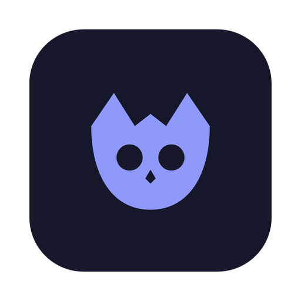
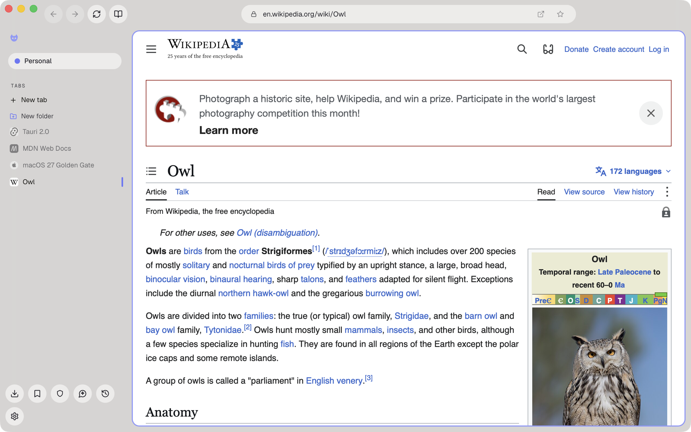
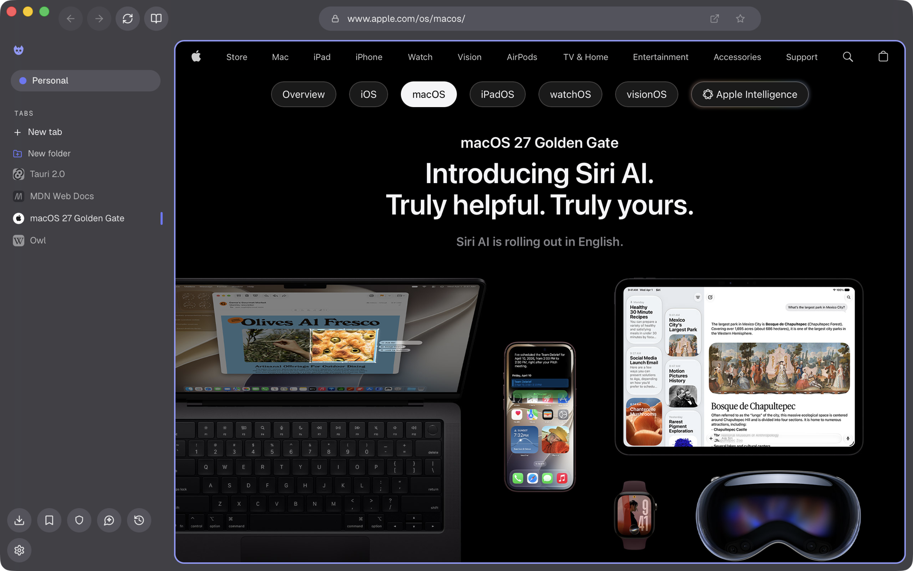
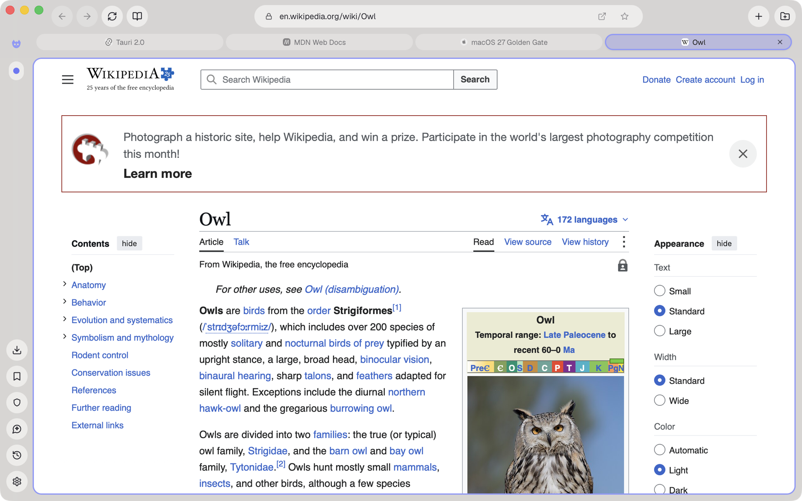
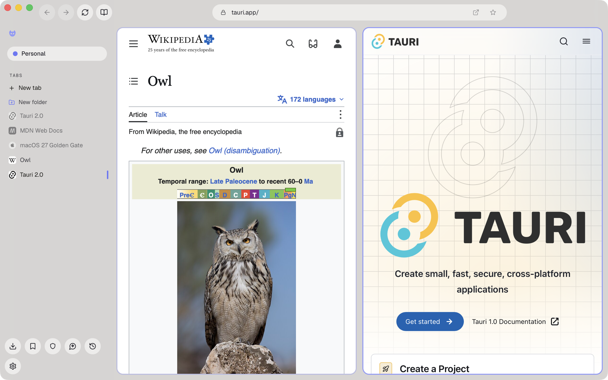
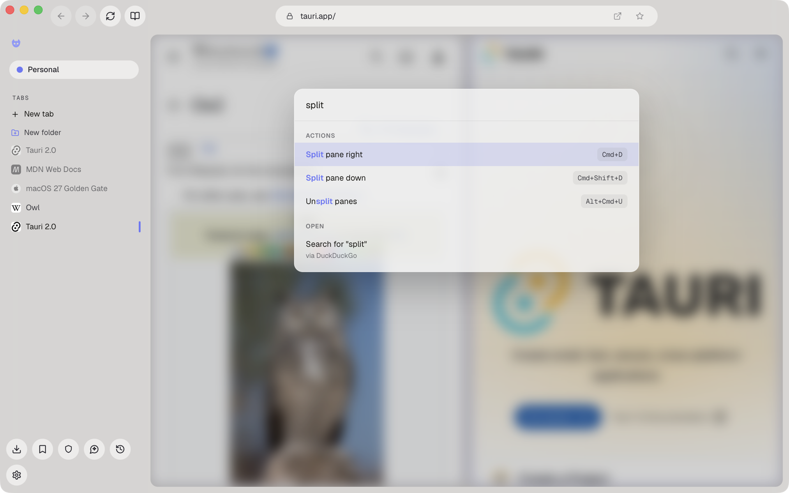
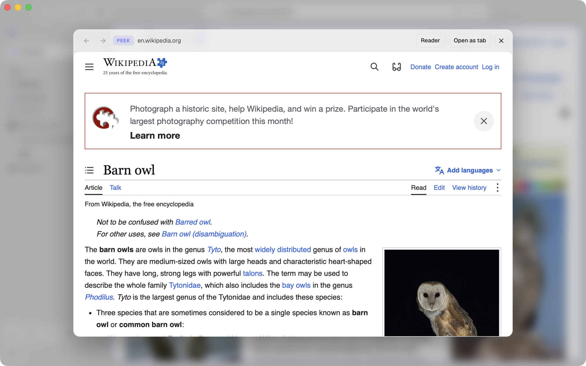

<div align="center">
  
  <h1>Wis</h1>

  <p><strong>Lightweight Secure Fast browser</strong></p>

  <p>
    
    
    
  </p>

  <p>
    <a href="https://fuyu-myk.github.io/wis-website/">Website</a>
    ·
    <a href="https://fuyu-myk.github.io/wis-website/docs/">Docs</a>
    ·
    <a href="https://github.com/fuyu-myk/wis-website">Website's source code</a>
  </p>
</div>

---

Wis is an open-source, lightweight, secure, and fast browser with AI integration built with Tauri 2 and React 18. A Safari WebKit engine for webpage rendering, a Rust backend for performance and security, a built-in tor VPN, peek function, as well as numerous security safeguards to protect your privacy.

## Screenshots

<p align="center">
  
</p>

<table>
  <tr>
    <td></td>
    <td></td>
  </tr>
  <tr>
    <td align="center">Dark theme</td>
    <td align="center">Top tabs layout</td>
  </tr>
  <tr>
    <td></td>
    <td></td>
  </tr>
  <tr>
    <td align="center">Split panes</td>
    <td align="center">Command palette</td>
  </tr>
  <tr>
    <td colspan="2"></td>
  </tr>
  <tr>
    <td colspan="2" align="center">Peek: Option+click a link to preview it without leaving the page</td>
  </tr>
</table>

## Features

### Privacy & security

- **Isolated workspaces**: color-coded profiles, each with its own cookies, proxy, and privacy mode
- **Private browsing**: fully ephemeral windows; nothing is saved, everything is wiped on close
- **Address autofill**: saved addresses, encrypted in your vault, offered at checkout and sign-up forms, and a new one offered for saving once you submit it
- **Password vault**: encrypted storage unlocked by Touch ID, Windows Hello or a vault password on Linux, with save prompts, autofill, CSV import/export, and recovery through your own age or SSH key
- **Stay logged in across restarts**: session logins survive quitting the app, encrypted at rest and auto-expiring after 14 days (macOS only)
- **Phishing/malware warnings** and a navigation safety interstitial that flags risky links before they load
- **Peek**: Option+click / Alt+click a link to preview it in an isolated mini-card without leaving the page
- **Built-in ad and tracker blocking**: cosmetic filtering, an element picker/zapper, Tampermonkey-style userscripts, and filter-list subscriptions
- **Cookie notice blocking**: consent banners are hidden by default, with an optional annoyances switch for social widgets and newsletter, notification and app prompts
- **Site panel**: click the padlock icon to see what was blocked on the page, turn blocking, JavaScript or fingerprinting protection off for one site, and forget the site's saved permissions, zoom and other settings (counts, JavaScript and fingerprinting protection on macOS only)
- **Clean links**: tracking parameters such as `utm_source` and `fbclid` come off links as you follow them, including links from other apps (same-tab clicks on macOS only)
- **HTTPS-First** enforcement and encrypted DNS (DoH)
- **CNAME uncloaking**: trackers hidden behind a site's own subdomains are caught through their DNS aliases
- **Built-in Tor VPN toggle** for one-click anonymous routing
- **Fingerprinting protection**: Safari's Advanced Tracking and Fingerprinting Protection in every workspace but Permissive ones, adding noise to canvas and audio readouts and hiding the screen size (macOS only)
- **Lockdown Mode per workspace**: WebKit's hardened mode for one workspace's pages, turning off the JavaScript compiler, WebAssembly, WebGL, WebRTC and more (macOS only)
- **Per-site camera/microphone permission prompts**
- **Encrypted profile backup and restore**

### Tabs & workspaces

- **Split panes**: divide a workspace into resizable, independently-loaded panes
- **Pinned tabs**, **tab folders** (color, rename, collapse), and **custom folder/workspace icons** (glyphs or emoji)
- **Video popout**: floats a playing video into an always-on-top mini player while you browse elsewhere
- **Per-tab audio indicator and mute**
- **Smart tab sleep**: inactive tabs unload to save memory and restore instantly, scroll position and all, on return
- **Archive idle tabs**: optionally close tabs you haven't opened in 12 hours to 30 days into Recently closed; pinned tabs and folders stay untouched
- **Recently closed in History**: reopen closed and archived tabs from a searchable list, per workspace or across all

### Productivity

- **Smart URL bar**: history suggestions, inline completion, custom search engines with keyword shortcuts
- **AI assistant**: an opt-in side panel that chats, summarises the page you are on, and answers questions about it. Bring your own key (Anthropic or OpenAI), or point it at a model running on your own machine with Ollama or LM Studio, which needs no key at all. It stays completely off until you set one up, conversations are never saved, and page content is only ever sent when you explicitly attach it. An optional web-access toggle lets a local model search the web and read pages through isolated, invisible page loads, so even an offline model can answer with current information
- **Reader mode** for a clean, distraction-free article view
- **Clear error pages** when a site fails to load (DNS, unreachable, timeout, certificate), with one-click retry
- **Bookmarks** with folders, pinning, drag-to-reorder, HTML import/export, and import of bookmarks and recent history from Chrome, Edge, Brave, Arc, Firefox, Zen and other Chromium or Firefox browsers
- **Downloads manager** with history, search, and an optional "ask where to save" prompt
- **Default browser integration**: set Wis as your system default; links from other apps open in Wis
- **Link routing**: send links from other apps to a chosen workspace by site
- **Two-finger swipe gestures** for back/forward navigation
- **Screenshot capture**: visible page, drag-select region, or full window, copy or save (region/window compositing is macOS only; Windows covers the visible tab)
- **Extensions** (macOS 15.4+, early): install a WebExtension from the Chrome Web Store, its folder or a `.zip` after a review of what it can do (those existing in the store update themselves, asking first when an update requires more); it runs in your workspaces, switchable per workspace, and in private ones only if you allow it. The puzzle button in the address bar runs them and opens their popups and options, and pinned ones get their own button with a live badge. When one asks for more access while running, Wis asks you first and remembers your answer, and each can run on every site or only on the sites you allow
- Command palette, find-in-page, fully rebindable keyboard shortcuts, print/export to PDF, and a configurable new-tab launchpad and homepage

### Customization

- **Custom themes**: build and share full light/dark color themes
- **Per-workspace backgrounds**: gradients, images, or GIF wallpapers
- **Motion controls**: Full, Reduced, or Off animation levels
- Choice of sidebar or top-tabs layout
- **Widget dock**: pin any web app as a persistent side panel, from the built-in catalog (chat, social, AI, calendar and notes apps) or any URL of your own

### Platform support

Wis is macOS-first. The Windows and Linux builds are previews: Windows is a growing tier-1 platform (encrypted vault via DPAPI + Windows Hello, Mica glass styling) and Linux follows the same design, but both are tested less than macOS. A few pieces remain macOS-only today: native session/history restore, encrypted session-cookie persistence, per-tab memory readouts in the task manager, and full window/region screenshot capture.

Wis renders with the OS system WebView (WebKit on macOS, via Tauri/wry) rather than Chromium: a tiny bundle, low RAM use, and Safari-class battery life, at the cost of a few structural tradeoffs: premium DRM streaming (e.g. Netflix 4K) is limited, with an "Open in default browser" fallback, and there's no cross-device sync or mobile app yet. Browser extensions are early: macOS 15.4 or later, installed from the Chrome Web Store, a folder or a `.zip`.

## Installation

Latest releases can be found in the [Releases](https://github.com/fuyu-myk/wis-browser/releases) page.

Wis needs macOS 14 (Sonoma) or later. The Windows and Linux builds are previews.

### Notes

Wis isn't code-signed yet, hence users will need to bypass the security warning when opening the app on first launch.

For macOS, there will be a popup stating that Apple is unable to check the app for malicious software. To work around this, you can navigate to **Settings** > **Privacy & Security**, scroll down until you see **Security**, then click **Open** and **Open Anyway**. *This button is available for about an hour after the first launch*. You will also need to enter your login password.

For Windows, there will be a popup stating that Windows protected your PC. To work around this, click **More info** and then **Run anyway**.

For Linux, **AppImage** requires `FUSE` to be installed. Without it, you can run `./Wis_*.AppImage --appimage-extract-and-run`.

## Building from source

**Prerequisites**:

- [Rust via rustup](https://rustup.rs), which installs the version `rust-toolchain.toml` pins
- [Node 22.13+](https://nodejs.org) and [pnpm 11+](https://pnpm.io)
- [Tauri prerequisites for your platform](https://tauri.app/start/prerequisites/)

**Run**:

```bash
# After cloning the repository
make install
make dev      # development
make build    # production build
```

**Checks**:

```bash
cd crates/shell && pnpm exec tsc --noEmit  # frontend type check
make lint                                  # clippy, then ESLint on the frontend
make test                                  # Rust tests, then the frontend tests
```

## Tech stack

- **App**: Rust (toolchain pinned in `rust-toolchain.toml`) and Tauri 2, with vendored, patched `wry`, `tao` and `tauri-runtime-wry`
- **Rendering**: the system webview, which is WebKit (WKWebView) on macOS, WebView2 on Windows and WebKitGTK on Linux
- **Interface**: React 18, TypeScript, Vite, TanStack Query
- **Storage**: SQLite via `rusqlite`
- **Network**: a per-workspace loopback proxy on `tokio` and `hyper`, Brave's `adblock` engine, DNS over HTTPS via `hickory`, and Tor via Arti
- **Vault**: ChaCha20-Poly1305, with the key held in the macOS Keychain or Windows DPAPI

## Contributing

All contributions are welcome! See [CONTRIBUTING.md](docs/contributing/CONTRIBUTING.md) for more information.

## License

Wis is licensed under the Apache-2.0 License. For more information, see [license](LICENSE).
